# Plano 4 — Redesign de UI/UX (v1.1.0, junto com o Plano 1)

> **Status:** ▶️ Em execução: 4.1, 4.2 e 4.3 concluídas (commits locais); próxima etapa **4.4**
> **Análise feita em:** 19/10/2026, sobre o commit `5ae82ac` (antes da etapa 1.2 do Plano 1)
> **Atualizado em:** 19/10/2026, sobre o commit `b593076` (Plano 1 concluído e aprovado pelo QA; v1.1.0 preparada, **não publicada**). Ver a seção [2.10](#210-o-que-o-plano-1-já-mudou)
> **Escopo:** tela principal (todas as abas), relatório de notas e relatório IBS/CBS (QuickReport), layouts do DANFE (`.fr3`) e textos da interface

---

## Sumário

1. [Objetivo](#1-objetivo)
2. [Relatório da análise](#2-relatório-da-análise)
3. [Decisões do usuário](#3-decisões-do-usuário)
4. [Proposta visual](#4-proposta-visual-a-validar-nos-mockups-da-41)
5. [Etapas de execução](#5-etapas-de-execução)
6. [Agentes](#6-agentes)
7. [Riscos e cuidados](#7-riscos-e-cuidados)
8. [Pendências](#8-pendências)

---

## 1. Objetivo

Deixar o ProXML **bonito, claro e confortável de usar**, sem mudar a regra fiscal:

- 🎨 **Visual coerente:** paleta, tipografia e espaçamento centralizados, mantendo a identidade atual (marinho + azul do logo).
- 🧭 **Navegação previsível:** o menu só navega e as ações ficam em botões claros, com estado ativo visível.
- ⚡ **App que não congela:** processamento e envio em segundo plano, com progresso, cancelamento e resumo.
- 🔎 **Grade de notas útil:** busca, ordenação, ações visíveis, valores em `R$ 1.234,56`.
- 🖨️ **Relatório profissional:** colunas alinhadas, valores formatados, período, filtro e rodapé com versão.
- ✍️ **Textos revisados:** mensagens sem erros, num padrão único, aprovadas pelo usuário.

---

## 2. Relatório da análise

### 2.1 Visão geral

| Item | Situação atual |
|------|----------------|
| Plataforma | VCL Win32, Delphi 10.2 Tokyo, `PerMonitorV2` no `.dproj` |
| Telas | 1 formulário (`FormPrincipal`) com `PageControl1` de abas ocultas: Resumo, Notas, Loading, Enviar, Config. Menu lateral com 6 itens: Resumo, Notas, Relatório, Relatório IBS/CBS, Enviar, Configurações |
| Relatórios | `FormRelatorios` (notas, `DMConfig.QryNotas`) e `FormRelatorioIBSCBS` (`DMConfig.QryNotasIBSCBS`), ambos `TQuickRep` A4 retrato |
| Janela | **Fixa** em 1136×699 (`BorderStyle = bsSingle`, sem maximizar) |
| Paleta | Marinho `#171A21`, azul `#2067CA`, fundo `#E9E9EB`, rótulos `#ADADAD` (cores espalhadas pelo `.dfm`) |
| Fontes | Formulário em **Tahoma**, painéis em **Segoe UI** e relatório em **Courier New** + Segoe UI + Arial |
| Componentes sem uso | `ProXML.FrameLoad` (animação Skia) não é usado; a aba `Loading` fica **vazia** |

Legenda de severidade: 🔴 **Alta** (atrapalha o uso ou passa informação errada) · 🟠 **Média** (atrito e retrabalho do usuário) · 🟡 **Baixa** (acabamento)

### 2.2 Estrutura e visual geral

| # | Sev. | Problema | Onde |
|---|------|----------|------|
| G1 | 🟠 | Janela fixa em 1136×699: a grade não aproveita monitores maiores e não dá para maximizar | `FormPrincipal` (`BorderStyle`, `BorderIcons`) |
| G2 | 🟠 | O cabeçalho marinho ocupa 113 px só com o logo, cerca de 16% da altura útil sem informação | `PnlCabecalho` / `PnlLogo` |
| G3 | 🔴 | **Hierarquia invertida nos cards:** o rótulo ("Valor Total", 21 px, `#ADADAD`) é maior que o valor (19 px, `clInactiveCaptionText`). O dado mais importante da tela é o menos visível | `Label3/5/6` × `LabelValorTotal/LabelbaseICMS/LabelValorICMS` |
| G4 | 🔴 | Contraste insuficiente: `#ADADAD` sobre branco dá **2,2:1** (o mínimo WCAG para texto é 4,5:1). Afeta rótulos, caminho da pasta e campos | Rótulos dos cards, `EditCaminho`, telas Enviar/Config (`clGray`) |
| G5 | 🟡 | Três famílias de fonte misturadas e tamanhos sem escala definida | Formulário, painéis, relatório |
| G6 | 🟡 | Cores repetidas como números mágicos em dezenas de componentes, sem fonte única | `.dfm` inteiro |
| G7 | 🟠 | Cards na coluna da direita (208 px) espremem a grade, e o README diz "cartões do topo" | `PnlInfo` |

### 2.3 Seleção de pasta e processamento

| # | Sev. | Problema | Onde |
|---|------|----------|------|
| P1 | 🔴 | **A tela congela** durante a leitura dos XMLs (thread principal). Com muitos arquivos o Windows mostra "Não respondendo" e não há como cancelar | `SpeedButton1Click` → `TCalculadoraXML.ProcessarXMLs` |
| P2 | 🟠 | Só o ícone de pasta (33×20 px) abre o seletor. O campo de caminho é somente leitura e não reage ao clique | `SkSvg1`, `EditCaminho` |
| P3 | 🟠 | O texto de instrução está **no `Text`** do campo, e o código compara o texto para saber se há pasta selecionada (frágil e quebra com qualquer mudança de texto) | `EditCaminho.Text` × `SpeedButton1Click` |
| P4 | 🟠 | Os botões são `TSpeedButton`: não recebem foco, não respondem a Tab/Enter, não têm hover nem estado desabilitado visível | `SpeedButton1`, `btnEnviarEmail`, `btnSalvarConfig` |
| P5 | 🟡 | Barra de progresso `TGauge` com fundo preto, sem texto ("X de N"), e `MaxValue = High(files)` termina com 1 a mais | `Gauge1`, `ProcessarXMLs` |
| P6 | 🟠 | O resultado do processamento é só um memo de texto corrido: não há contadores de lidos / ignorados / com erro | `Memo1` (aba Resumo) |
| P7 | 🟡 | Totais formatados com `FloatToStrF(ffFixed)`, **sem separador de milhar** (`R$ 12345,67`) | `ProcessarXMLs` |

### 2.4 Menu lateral e navegação

| # | Sev. | Problema | Onde |
|---|------|----------|------|
| N1 | 🔴 | **"Relatório" e "Enviar" executam ações ao serem clicados:** gravam no banco e compactam com o WinRAR na hora, mesmo que o usuário só quisesse olhar a tela | `CategoryButtons1Categories0Items2Click` / `Items3Click` |
| N2 | 🟠 | Sem indicação do item ativo (`SelectedButtonColor = RegularButtonColor = clWhite`) | `CategoryButtons1` |
| N3 | 🟡 | Menu sem ícones, cabeçalho "Opções" sem função e item `'Notas '` com espaço sobrando | `Panel8`, `CategoryButtons1` |
| N4 | 🟠 | Gerar DANFe ou relatório troca para a aba `Loading`, que está **vazia** (animação comentada): a tela fica em branco | `Loading`, `GerarDanfe`, `GravarNotasDB` |
| N5 | 🟡 | Depois de salvar as configurações, o app volta sozinho para o Resumo | `btnSalvarConfigClick` |

### 2.5 Tela Notas (grade)

| # | Sev. | Problema | Onde |
|---|------|----------|------|
| T1 | 🔴 | **Ações escondidas:** "Copiar Chave" e "Gerar DANFe" só existem no botão direito | `PopupMenu` |
| T2 | 🟠 | Valores sem `DisplayFormat`: aparecem como float cru, sem `R$` e sem milhar | `FDMemTable1vtotal` etc. |
| T3 | 🟠 | Sem busca e sem ordenação. Achar uma nota numa lista grande é manual | `DBGrid1` |
| T4 | 🟡 | `DBGrid` no visual padrão do Windows: sem zebra, seleção em azul do sistema, títulos sem destaque | `DBGrid1` |
| T5 | 🟡 | Altura da linha ajustada **dentro de `OnDrawColumnCell`** (roda a cada célula pintada) | `DBGrid1DrawColumnCell` |
| T6 | 🟡 | Sem estado vazio ("Nenhuma nota. Selecione uma pasta e clique em Processar") | aba Notas |
| T7 | 🟡 | O item que copia a chave se chama `GerarPDF1` (nome enganoso para manutenção) | `PopupMenu` |

### 2.6 Telas Enviar e Configurações

| # | Sev. | Problema | Onde |
|---|------|----------|------|
| E1 | 🔴 | **Erros ao salvar são engolidos** (`except end` vazio): o usuário não sabe se salvou | `btnSalvarConfigClick`, `FormCreate` |
| E2 | 🔴 | O envio de e-mail congela a tela (`UseThread := False`) e não mostra progresso | `LerConfigEmail`, `EnviaArquivo` |
| E3 | 🟠 | O usuário não vê o que será enviado (quantos XMLs, tamanho do anexo) | aba Enviar |
| E4 | 🟠 | Campos com "borda falsa" (`TShape` atrás de `TEdit` sem borda): sem destaque de foco e alinhamento manual | `Shape2..17` |
| E5 | 🟠 | Sem validação do e-mail de destino e da porta antes de enviar | `EditEmailEnviar`, `EditPorta` |
| E6 | 🟡 | Rótulo **"TSL"** (o certo é TLS); checkboxes em cinza ao lado do campo Porta | `CheckBoxTSL`, `CheckBoxSSL` |
| E7 | 🟡 | Não há como testar o SMTP sem enviar um e-mail de verdade | aba Config |

### 2.7 Textos e mensagens

| # | Sev. | Problema | Exemplos atuais |
|---|------|----------|-----------------|
| X1 | 🟠 | Erros de digitação | "Foram **processasdos**", "**diretótio**", "Gera**ção** de relat**é**io" (comentário) |
| X2 | 🟡 | Tom inconsistente e exclamações duplas | "Configuração salva com sucesso **!!**", "Email enviado com sucesso**!!**" |
| X3 | 🟡 | Termos trocados | "Por favor selecione um **repositório**" (é uma pasta), "Email"/"e-mail" |

### 2.8 Relatório de notas (QuickReport)

| # | Sev. | Problema | Onde |
|---|------|----------|------|
| R1 | 🔴 | **Colunas desalinhadas:** título "Chave" em x=206 e dado em x=116; título "Base de Cálculo" em x=624 e dado em x=642; títulos alinhados à esquerda e valores à direita | `QRBand166` × `QRBand167` |
| R2 | 🟠 | Valores impressos como texto cru (a `QryNotas` traz tudo como `WideString`): sem `R$` e sem milhar | `DMConfig.QryNotas`, `QRDBText250/252/253` |
| R3 | 🟠 | Falta a coluna **Data**, embora a query já traga `DATA` | `QRBand167` |
| R4 | 🟠 | Cabeçalho de **243 px** com "Pro XML" em 48 px: sobra pouco espaço para as linhas na 1ª página | `QRBand166` |
| R5 | 🟠 | Não informa período (data inicial–final), filtro aplicado nem a pasta de origem | `QRBand166` |
| R6 | 🟡 | A quantidade de notas aparece como número solto ("19"), sem rótulo, em Courier New | `QRLabelQt` |
| R7 | 🟡 | Subtítulo "XMLs de notas **modelos 65**" fica desatualizado com o Plano 1 | `QRLabel602` |
| R8 | 🟡 | Rodapé com e-mail pessoal do autor e fonte Courier itálica | `QRLabel609` |
| R9 | 🟡 | Totais do resumo posicionados à mão (x=318/414/426), com rótulos desalinhados entre si | `QRBand169` |

### 2.9 O que já funciona bem (manter)

- ✅ Identidade visual forte: logo + marinho + azul.
- ✅ Ícones SVG via Skia (nítidos em qualquer DPI).
- ✅ Estrutura "menu à esquerda + conteúdo" é familiar para o usuário.
- ✅ `PerMonitorV2` já habilitado no projeto.
- ✅ Menu de contexto da grade (continua existindo como atalho).

### 2.10 O que o Plano 1 já mudou

> Conferido no código em `b593076`. Vale mais que as tabelas acima quando houver conflito.

| Item | Situação depois do Plano 1 |
|------|----------------------------|
| G3, G7 | Continuam. Agora são **5 cards** (Valor Total, Base ICMS, Valor ICMS, Total IBS, Total CBS) empilhados na coluna da direita (`PnlInfo`), com o mesmo problema de hierarquia e contraste |
| P3 | Continua. O texto passou a "Selecione uma pasta contendo XMLs de Nota Fiscal" e ainda é comparado no código |
| P7 | Continua. A formatação foi centralizada em `TFormPrincipal.FormatarValor`, ainda sem separador de milhar |
| N1 | **Parcial.** "Enviar" só abre a tela e a compactação acontece no clique em "Enviar Email" (1.7). "Relatório" e "Relatório IBS/CBS" ainda gravam no banco ao clicar no menu |
| N4 | **Parcial.** Depois de qualquer relatório (sucesso ou erro) a tela volta para Notas, mas a aba Loading continua vazia |
| N6 (novo) | O menu tem 6 itens. A tela "Relatórios" da 4.4 substitui os itens "Relatório" e "Relatório IBS/CBS" |
| T2 | **Parcial.** Os campos novos têm `DisplayFormat '#,##0.00'`; a grade ganhou a coluna Modelo |
| T5 | ✅ **Resolvido** na 1.4 (`AjustarAlturaLinhasGrade`, fora do evento de pintura) |
| R1, R3 | Continuam. O relatório de notas ganhou a coluna Modelo; a Data ainda falta. O relatório IBS/CBS (novo) segue o mesmo padrão antigo |
| R5 | **Parcial.** O subtítulo dos dois relatórios mostra o filtro de modelo quando não é "Todos" |
| R7 | ✅ **Resolvido** na 1.6 (subtítulo "XMLs de Nota Fiscal …") |
| R8 | Continua nos dois relatórios |
| E1, E2 | Continuam |
| X1, X2 | Continuam ("processasdos", "Sem dados para gerar relatório !!", "Email enviado com sucesso!!") |
| Leitura × tela | **Parcial.** `LerNotaXML` e `CalcularTotais` já não acessam a tela; `ProcessarXMLs` ainda escreve em `Memo1`, `Gauge1` e na `FDMemTable1` |
| Gravação no banco | Na **thread principal, com transação** (decisão do Plano 1, porque a mesma `TFDConnection` é usada pela tela). A 4.6 não pode mover essa gravação para outra thread sem conexão própria |
| Espera do DANFE | Limite de 15 s com `Application.ProcessMessages`; só o próprio DANFE é protegido contra reentrada |

**Itens herdados do Plano 1 (decisão do usuário: entram no Plano 4)**

| # | Sev. | Problema | Onde | Etapa |
|---|------|----------|------|-------|
| H1 | 🟡 | "Folha 1/0" no cabeçalho do DANFE paisagem | `bin/Report/NFe/DANFePaisagem.fr3` | 4.8 |
| H2 | 🟡 | Linha horizontal cortando "Emissão … Via Consumidor" no DANFCe A4 | `bin/Report/NFe/DANFeNFCeA4.fr3` | 4.8 |
| H3 | 🟠 | Os XMLs copiados para o e-mail saem como `<chave>-nfe-nfe.xml` (o campo `chave` já termina em `-nfe`) | `ComprimirArquivos` | 4.7 |
| H4 | 🟡 | Durante a espera do PDF do DANFE dá para clicar em Processar, trocar o filtro ou abrir relatório | `AguardarArquivoPDF` | 4.6 |
| H5 | 🟡 | `insert into LOG` e `insert into config` sem lista de colunas | `DM.pas` (`CreateLog`, `GravarConfig`) | 4.2 |

---

## 3. Decisões do usuário

> Decididas em 19/10/2026. Nenhum agente altera estas decisões sem perguntar.

| Tema | Decisão |
|------|---------|
| **Ordem** | ~~Por último, depois dos Planos 1, 2 e 3~~ → **Logo depois do Plano 1 e antes dos Planos 2 e 3** (decisão de 19/10/2026). Os Planos 1 e 4 são publicados **juntos** |
| **Abordagem visual** | **VCL padrão + paleta própria** numa unit de tema. Sem VCL Styles e sem suíte de terceiros |
| **Janela** | **Redimensionável**, com mínimo de **1024×640** e maximizar habilitado |
| **Cards** | **Faixa horizontal no topo**, com 5 cards (Valor Total, Base ICMS, ICMS, IBS, CBS) e o valor em destaque |
| **Relatório** | **Redesenhar no QuickReport** (notas e IBS/CBS no mesmo padrão) |
| **Processamento** | **Thread + progresso "X de N" + Cancelar + resumo final**. O envio de e-mail também sai da thread principal |
| **Tema** | **Só claro**. As cores ficam centralizadas para permitir tema escuro no futuro |
| **Protótipo** | **Novo agente `ux-designer` + mockups HTML** em `docs/ui/`, aprovados antes de qualquer `.dfm` |
| **Paleta** | **Manter a identidade** (marinho + azul) e refinar o contraste, com cores de sucesso, aviso e erro |
| **Navegação** | **Menu só navega; ações em botões.** Tela "Relatórios" com 2 botões; "Enviar" mostra o anexo e só compacta ao clicar em Enviar; item ativo destacado; ícones no menu |
| **Grade** | Barra de ações (Copiar chave, Gerar DANFe) **+** busca por número/chave **+** ordenação pelo título **+** duplo clique gera o DANFe |
| **Rodapé do relatório** | "Gerado pelo ProXML vX.Y · data/hora · Página X de Y". O crédito ao autor vai para uma **tela Sobre** |
| **Botões** | **Controle próprio `TProBotao`** (`TCustomControl`, criado em runtime, sem pacote na IDE): foco, hover, desabilitado, primário/secundário |
| **Extras** | Lembrar **última pasta** e **tamanho/posição da janela**; **arrastar e soltar** pasta; **Testar conexão** SMTP; **Exportar grade para CSV** |
| **Versão** | ~~v1.3.0~~ → **v1.1.0**, uma única release com os Planos 1 e 4. O instalador (Plano 2) continua como v1.2.0 |
| **Dependências dos Planos 2 e 3** | **Adaptar:** a tela Enviar mostra o anexo `.rar` atual (o ZIP vem no Plano 2); a tela Sobre fica sem link do site até o Plano 3; os prints do site saem do Plano 4 (o site já nasce com o visual novo no Plano 3) |
| **Itens herdados do Plano 1** | H1–H5 da seção 2.10 entram no Plano 4 |
| **Pendências PD-1 a PD-6** | **Sugestões aceitas** (ver seção 8) |
| **Etapa 4.1 (19/10/2026)** | Paleta (com `CorSucesso #18793A`, `CorAviso #8F5600` e `CorBordaCampo #878E9B`), tipografia (valor do card em **13 pt**), ícones **Lucide** (ISC/MIT, crédito na tela Sobre), mockups e glossário (`docs/ui/`) **aprovados** |
| **D1–D12 do `ux-designer`** | **Sugestões aceitas:** D1 cards na área de conteúdo (13 pt) · D2 cards ocultos em Enviar/Configurações/Sobre · D3 colunas de valor aparecem conforme a largura · D4 chave com 44 dígitos (sem "-nfe") na grade e no "Copiar chave" · D5 busca não vale para Relatórios/Enviar · D6 seletor de modelo em botões segmentados · D7 "ProXML" em texto marinho no relatório · D8 totais em linha alinhada às colunas · D9 relatório IBS/CBS com **Nº antes de Modelo** (substitui a ordem do Plano 1) · D10 animação recolorida · D11 "(R$)" só no título da coluna · D12 grafia **DANFE** |
| **Logo** | Versão **vetorial (SVG)** do logo atual, feita no Plano 4 e aprovada pelo usuário antes de entrar no app |
| **Chave de acesso (D4)** | Vem de `NFe/infNFe/@Id` sem o prefixo "NFe" (44 dígitos), não do nome do arquivo. `protNFe/infProt/chNFe` só confere. **Id sem 44 dígitos ou `chNFe` diferente do `Id` → "Arquivo não processado"** com o motivo no log. No CSV a chave é gravada como texto (sem notação científica no Excel) |
| **Texto 5.25 do glossário** | "o arquivo não é uma Nota Fiscal com protocolo de autorização (falta a tag nfeProc)" (vale também para eventos, CT-e etc.) |
| **Avisos de homologação e de entrada** | O **Resumo** mostra uma linha de aviso quando a pasta tiver notas de homologação (`tpAmb=2`) e/ou de entrada (`tpNF=0`) somadas aos totais (texto a definir pelo `ux-designer` no glossário, com aprovação do usuário) |
| **Notas canceladas** | **Fora do escopo** do Plano 4. Hoje a nota cancelada continua somada (o cancelamento é um evento separado e o `nfeProc` mantém cStat 100). Registrado como ideia para um plano futuro |
| **Textos do aviso (20/10/2026)** | Aprovados os itens 5.29–5.31 do glossário (faixa de aviso no Resumo) e as linhas de log por nota 5.32/5.33 (homologação e NF-e de entrada) |
| **D7 revista (20/10/2026)** | O cabeçalho do relatório A4 usa o **logo vetorial claro** (`proxml-logo-claro.svg`) no lugar do texto "ProXML" |
| **Decisões da 4.2 (20/10/2026)** | Rolagem provisória em Enviar e Configurações em janela pequena, **mantida até a 4.7**. Janela maximizada abre no monitor salvo; se ele não existir, centralizada e maximizada no principal. "Copiar chave" **tolerante** à área de transferência ocupada (tentar de novo e avisar), na **4.5**, com texto novo no glossário para aprovação |
| **Mínimo da janela com DPI (20/10/2026)** | O mínimo é sempre **1024×640 pixels reais da tela**, em qualquer escala do Windows (a VCL não pode escalá-lo); o layout se adapta. Implementado na 4.3 e conferido na 4.10 |
| **Processar travado após erro (20/10/2026)** | Defeito antigo (o `Enabled := True` fora de `finally`): corrigir na **4.6**, junto com o processamento em segundo plano |
| **Decisões da 4.3 (20/10/2026)** | Pasta salva que não existe mais: mensagem 2.14 do glossário **ao abrir o app** (não modal), campo vazio. Caminho longo: **aceito como está** (cortado no fim, caminho completo na dica). Aperto da barra/cards em 125%/150% na janela mínima: **tratar na 4.10** com prints reais. Link "Sobre" visível e sem ação até a 4.7. Menu lateral com 200 px (visual do menu na 4.4) |
| **Decisões da 4.4 (20/10/2026)** | Menu feito com **`TProBotao` em modo menu** (5 itens; o `TCategoryButtons` sai). Enquanto a tela Carregando está aberta, **só o menu** fica bloqueado já na 4.4; o bloqueio completo (H4) continua na 4.6. Salvar configurações **só deixa de trocar de tela**; a mensagem atual fica até a 4.7 (rótulo inline do glossário). **D10 revista:** o `FrameLoad` tinha uma engrenagem (`#5EA4E3`/`#C1C6C8`), não o spinner ciano + preto da D10; a tela Carregando usa **o spinner** (`src/json`) recolorido para `CorPrimaria`/`CorMarinho`. Texto novo **8.8a** no glossário (há notas, mas nenhuma no modelo escolhido). Aceitas as escolhas de teclado do `delphi-dev`: menu é uma parada só do Tab, antes do conteúdo; o `PageControl1` sai do Tab; ao sair da Carregando o foco volta para a grade ou para "Gerar relatório"; Relatórios e Carregando sem a moldura do `PageControl1` |
| **QA (20/10/2026)** | O `qa-reviewer` revisa só nos pontos de controle maiores (4.10, cobrindo da 4.3 em diante). Nas etapas, vale a bateria do `delphi-dev` + teste do usuário na IDE |
| **Textos** | O `ux-designer` propõe um **glossário de mensagens** (antes → depois) e o usuário aprova junto com os mockups |

---

## 4. Proposta visual (a validar nos mockups da 4.1)

> Os valores abaixo são **ponto de partida** para o `ux-designer`. Só valem depois que o usuário aprovar os mockups.

### 4.A Paleta

| Token | Cor | Uso | Contraste* |
|-------|-----|-----|-----------|
| `CorMarinho` | `#171A21` | Cabeçalho, título dos cards | — |
| `CorPrimaria` | `#2067CA` | Botão primário, item ativo, links | 5,4:1 com texto branco ✅ |
| `CorPrimariaHover` | `#1A56AB` | Hover do primário | — |
| `CorPrimariaSuave` | `#E8F0FB` | Seleção na grade, item ativo do menu | — |
| `CorFundo` | `#F2F3F5` | Fundo da janela (refino do `#E9E9EB`) | — |
| `CorSuperficie` | `#FFFFFF` | Cards, painéis, grade | — |
| `CorBorda` | `#DADDE3` | Bordas de campo e divisórias | — |
| `CorTexto` | `#1F2430` | Texto principal e **valores dos cards** | 15:1 ✅ |
| `CorTextoSecundario` | `#5B6270` | Rótulos, dicas (substitui o `#ADADAD`) | 6,1:1 ✅ |
| `CorSucesso` | `#1E8E3E` | "Autorizadas", envio OK | — |
| `CorAviso` | `#B26A00` | "Ignoradas" | — |
| `CorErro` | `#C62828` | "Com erro", validação de campo | — |

\* Contraste sobre fundo branco, exceto onde indicado. Referência: WCAG AA ≥ 4,5:1.
⚠️ No Delphi, `TColor` é **BGR**. A unit de tema declara as cores com `RGB(r, g, b)` para evitar inversão.

### 4.B Tipografia (fonte única: **Segoe UI**)

| Estilo | Tamanho | Peso | Uso |
|--------|---------|------|-----|
| Título de tela | 14 pt | Semibold | "Notas", "Enviar", "Configurações" |
| Valor do card | 16 pt | Semibold | `R$ 12.345,67` |
| Rótulo do card | 9 pt | Regular | "Valor Total" |
| Corpo / grade | 10 pt | Regular | Texto, campos, linhas da grade |
| Legenda | 9 pt | Regular | Dicas, contadores |

Espaçamento em múltiplos de **8 px** (8 / 16 / 24 / 32).

### 4.C Esqueleto da tela principal (proposta)

```text
┌────────────────────────────────────────────────────────────────────────────┐
│ [logo] ProXML                                                       ⓘ Sobre │  cabeçalho marinho, ~56 px
├────────────────────────────────────────────────────────────────────────────┤
│ 📁 C:\XMLs\Outubro 2026                    [Selecionar…]  [Todos ▾]  [▶ Processar] │
├───────────────┬────────────────────────────────────────────────────────────┤
│               │ ┌───────────┐┌──────────┐┌─────────┐┌─────────┐┌─────────┐ │
│ ▌ Resumo      │ │Valor Total││Base ICMS ││ICMS     ││IBS      ││CBS      │ │
│   Notas       │ │R$ 12.345,6││R$ 9.876,5││R$ 1.234 ││R$ 456,78││R$ 789,01│ │
│   Relatórios  │ └───────────┘└──────────┘└─────────┘└─────────┘└─────────┘ │
│   Enviar      │ ┌────────────────────────────────────────────────────────┐ │
│   Configurações│ │                                                        │ │
│               │ │            conteúdo da tela ativa                      │ │
│               │ │     (cresce junto com a janela)                        │ │
│               │ │                                                        │ │
│               │ └────────────────────────────────────────────────────────┘ │
└───────────────┴────────────────────────────────────────────────────────────┘
   menu fixo ~200 px                 área flexível
```

### 4.D Telas e estados que os mockups precisam cobrir

| Tela | Estados |
|------|---------|
| Resumo | vazio (primeiro uso) · processando (X de N + Cancelar) · concluído (contadores + log) · cancelado |
| Notas | vazio · com dados · busca sem resultado · nota selecionada (barra de ações ativa) |
| Relatórios | sem dados (botões desabilitados com dica) · com dados |
| Enviar | sem notas · pronto (anexo: N XMLs, tamanho) · enviando · enviado · erro |
| Configurações | normal · campo inválido · testando conexão · conexão OK/falhou · salvo |
| Sobre | versão, autor, GitHub |
| Carregando | gerando DANFe · gerando relatório (com a animação Skia já existente) |
| Relatório A4 | 1ª página · página intermediária · última página com totais |

---

## 5. Etapas de execução

### 5.1 Fluxo

```mermaid
flowchart LR
    P1["Plano 1<br/>concluído"] --> E41
    E41["4.1 Tokens, mockups<br/>e glossário<br/>🎨 ux-designer"] -->|"✋ aprovação<br/>do usuário"| E42
    E42["4.2 Fundação<br/>tema, TProBotao, janela<br/>🛠️ delphi-dev"] --> E43
    E43["4.3 Cabeçalho, pasta<br/>e cards<br/>🛠️ delphi-dev"] --> E44
    E44["4.4 Menu e<br/>navegação<br/>🛠️ delphi-dev"] --> E45
    E45["4.5 Tela Notas<br/>🛠️ delphi-dev"] --> E46
    E46["4.6 Processamento<br/>em thread<br/>🛠️ delphi-dev"] --> E47
    E47["4.7 Enviar, Config<br/>e Sobre<br/>🛠️ delphi-dev"] --> E48
    E48["4.8 Relatórios<br/>QuickReport<br/>🛠️ delphi-dev"] --> E49
    E49["4.9 Revisão visual<br/>🎨 ux-designer"] --> E410
    E410["4.10 QA final<br/>🔍 qa-reviewer"] --> E412
    E412["4.12 Release v1.1.0<br/>(Planos 1 + 4)<br/>📦 release-manager"]
```



~~Ao fim de **cada** etapa do `delphi-dev`, o `qa-reviewer` revisa o diff e compila.~~ **Atualizado em 20/10/2026 (decisão do usuário):** o `qa-reviewer` só entra nos **pontos de controle maiores**: a revisão completa da **4.10**, que cobre todas as etapas desde a 4.3, cujo QA foi interrompido. Em cada etapa, o `delphi-dev` roda a própria bateria de regressão (dois separadores, banco antigo e novo) e o usuário testa na IDE antes do commit. A etapa seguinte só começa com o usuário de acordo.

### 5.2 Resumo das etapas

| Etapa | Entrega | Agente principal | Revisão | Itens resolvidos |
|-------|---------|------------------|---------|------------------|
| 4.1 | Tokens, mockups HTML, glossário | `ux-designer` | **Usuário** | — (base de tudo) |
| 4.2 | Unit de tema, `TProBotao`, janela redimensionável, preferências | `delphi-dev` | `qa-reviewer` | G1, G5, G6, P4, H5 |
| 4.3 | Cabeçalho, barra de pasta, faixa de cards | `delphi-dev` | `qa-reviewer` | G2, G3, G4, G7, P2, P3, P7 |
| 4.4 | Menu com ícones e item ativo, telas sem ação implícita, tela de carregamento | `delphi-dev` | `qa-reviewer` | N1–N6 |
| 4.5 | Grade: barra de ações, busca, ordenação, CSV, estado vazio | `delphi-dev` | `qa-reviewer` | T1–T7 |
| 4.6 | Processamento e envio em thread, progresso, cancelar, resumo | `delphi-dev` | `qa-reviewer` + `nfe-fiscal` | P1, P5, P6, E2, H4 |
| 4.7 | Enviar, Configurações, Testar conexão, Sobre, textos novos | `delphi-dev` | `qa-reviewer` | E1, E3–E7, X1–X3, H3 |
| 4.8 | Relatório de notas e IBS/CBS redesenhados; ajustes nos `.fr3` do DANFE | `delphi-dev` | `qa-reviewer` + `nfe-fiscal` | R1–R9, H1, H2 |
| 4.9 | Comparação mockup × app (prints do usuário) | `ux-designer` | **Usuário** | Ajustes finos |
| 4.10 | Bateria final (DPI, teclado, gabarito, banco antigo) | `qa-reviewer` | — | — |
| ~~4.11~~ | ~~Prints novos no site~~ → movido para o **Plano 3** (o site nasce com o visual novo) | — | — | — |
| 4.12 | README, notas, pacote, tag e Release **v1.1.0** (Planos 1 + 4) | `release-manager` | **Usuário** | — |

---

### Etapa 4.1 — Tokens, mockups e glossário · `ux-designer` 🎨

**Entregas** (pasta `docs/ui/`):
- `docs/ui/tokens.md`: paleta, tipografia, espaçamento e componentes (botão primário/secundário, campo, card, item de menu, grade), com os valores `RGB()` prontos para o Delphi.
- `docs/ui/mockups/*.html`: um arquivo por tela, com **todos os estados da seção 4.D**, em 1024×640 e 1366×768. HTML/CSS estático, sem scripts externos.
- `docs/ui/mockups/relatorio-a4.html`: relatório de notas e relatório IBS/CBS em proporção A4.
- `docs/ui/glossario.md`: **todas** as mensagens e rótulos da interface, em tabela *antes → depois*, com tom padronizado.
- `docs/ui/icones.md`: os ícones SVG escolhidos para o menu e os botões, com origem e licença.

**Aceite:**
- [x] O usuário aprovou paleta, tipografia e os mockups (19/10/2026, com as sugestões D1–D12).
- [x] O usuário aprovou o glossário (19/10/2026; o `nfe-fiscal` confere os textos fiscais).
- [x] Logo vetorial aprovado pelo usuário (19/10/2026): `docs/ui/logo/proxml-logo-escuro.svg` (cabeçalho) e `proxml-logo-claro.svg` (relatório e Sobre).
- [ ] Os contrastes de texto passam de 4,5:1 (tabela no `tokens.md`).
- [ ] Os ícones têm licença compatível com distribuição gratuita.

---

### Etapa 4.2 — Fundação · `delphi-dev` 🛠️

- Nova unit **`view/ProXML.Tema.pas`**: constantes de cor (`RGB()`), fontes e espaçamentos dos tokens, mais um `AplicarTema(Form)` que padroniza a fonte (fim do Tahoma/Courier na tela).
- Nova unit **`view/ProXML.Botao.pas`** com **`TProBotao`** (`TCustomControl`):
  - estilos **primário** e **secundário**; estados normal, hover, pressionado, foco (contorno visível) e desabilitado;
  - `TabStop`, ativação por Enter/Espaço, `Action` opcional e ícone SVG opcional (Skia);
  - **criado em runtime** no `FormCreate`, substituindo os `TSpeedButton`. Os painéis do `.dfm` viram apenas o ponto de encaixe. Nada é instalado na IDE.
- **Janela:** `BorderStyle = bsSizeable`, maximizar habilitado, `Constraints.MinWidth = 1024` e `MinHeight = 640`. Revisar `Align`/`Anchors` de toda a tela: a grade e o log crescem, o menu e os cards têm tamanho fixo.
- **`TActionList`** com atalhos: `Ctrl+O` (selecionar pasta), `F5` (processar), `Ctrl+F` (buscar na grade), `Ctrl+C` (copiar chave), `Ctrl+D` (gerar DANFe).
- **Preferências:** última pasta e tamanho/posição/estado da janela salvos na tabela `config`, com **migração idempotente** (`PRAGMA table_info` + `ALTER TABLE`) e `UPDATE` com colunas explícitas. A janela restaurada fica dentro da área visível se o monitor tiver mudado.
- **H5:** `insert into LOG` e `insert into config` passam a listar as colunas explicitamente.

**Aceite:**
- [ ] Build OK, sem avisos novos.
- [ ] A janela redimensiona e maximiza sem sobreposição; abaixo de 1024×640 ela não encolhe.
- [ ] Todos os botões recebem foco por Tab e respondem a Enter/Espaço.
- [ ] Nenhuma cor nova escrita direto no `.dfm`/`.pas` fora de `ProXML.Tema.pas`.
- [ ] Funciona com `notas.db` antigo e novo (pasta e janela restauradas no segundo uso).

---

### Etapa 4.3 — Cabeçalho, seleção de pasta e cards · `delphi-dev` 🛠️

- **Cabeçalho** mais baixo (altura definida no mockup), com logo, nome e acesso à tela **Sobre**.
- **Barra de pasta:**
  - clicar no campo **ou** no botão "Selecionar…" abre o seletor;
  - texto de instrução só no `TextHint`; "há pasta?" passa a ser `Trim(EditCaminho.Text) <> ''` (sem comparar texto);
  - **arrastar e soltar** uma pasta do Explorer na janela (`DragAcceptFiles` + `WM_DROPFILES`; se vier arquivo, usa a pasta dele);
  - o seletor de modelo do Plano 1 (**Todos / NF-e 55 / NFC-e 65**) e o botão **Processar** (`TProBotao` primário) ficam nessa barra.
- **Faixa de 5 cards** no topo da área de conteúdo, substituindo `PnlInfo`: rótulo pequeno em `CorTextoSecundario`, **valor grande em `CorTexto`**, ícone SVG e mesma largura para todos.
- Formatação monetária única (`FormatFloat('"R$ "#,##0.00', ...)` com `TFormatSettings` pt-BR explícito), usada nos cards, na grade e nos relatórios.
- O filtro de modelo continua recalculando os cards (regra do Plano 1, sem mudança).

**Aceite:**
- [ ] Os valores dos cards batem com `tests/gabarito/notas.csv` nos filtros Todos/55/65.
- [ ] `R$ 1.234.567,89` cabe no card em 1024×640.
- [ ] Arrastar uma pasta preenche o caminho; arrastar um arquivo usa a pasta dele.
- [ ] Sem pasta selecionada, Processar fica desabilitado com dica.

---

### Etapa 4.4 — Menu e navegação · `delphi-dev` 🛠️

- O menu lateral **só navega**: Resumo · Notas · Relatórios · Enviar · Configurações.
  - Item ativo com fundo `CorPrimariaSuave` e barra lateral `CorPrimaria`; hover visível; ícone SVG em cada item.
  - Remover o cabeçalho "Opções" e o espaço em `'Notas '`.
  - Se o `TCategoryButtons` não permitir esse visual, o `delphi-dev` **avisa e propõe** a troca (ex.: itens `TProBotao` em modo "menu") antes de implementar.
- **Nova tela Relatórios:** botões "Relatório de Notas" e "Relatório IBS/CBS" (este desabilitado com dica quando não há nota com IBS/CBS), mais o texto do filtro em uso. Substitui os itens de menu "Relatório" e "Relatório IBS/CBS" do Plano 1 (N6). A gravação no banco (`GravarNotasDB`) **só acontece ao clicar no botão**.
- ~~Tela Enviar deixa de compactar ao abrir~~ ✅ já feito no Plano 1 (1.7).
- **Tela Carregando** usa a animação Skia que já existe (`ProXML.FrameLoad` / `src/gif`), com o texto da operação ("Gerando DANFe da nota 1234…").
- Salvar configurações **não** troca de tela.

**Aceite:**
- [ ] Abrir qualquer tela não grava, não compacta e não envia nada.
- [ ] O item ativo do menu sempre corresponde à tela exibida, inclusive quando a troca vem do código.
- [ ] A tela Carregando aparece com a animação durante o DANFe e o relatório.

---

### Etapa 4.5 — Tela Notas · `delphi-dev` 🛠️

- **Barra de ações** acima da grade: `Copiar chave` · `Gerar DANFe` · `Exportar CSV` · campo **Buscar** (número ou chave).
  - "Copiar chave" e "Gerar DANFe" ficam habilitados só com nota selecionada.
  - Ao copiar, aparece uma confirmação discreta ("Chave copiada").
- **Busca** filtra enquanto se digita, **combinada** com o filtro de modelo do Plano 1. Os cards continuam refletindo **apenas** o filtro de modelo (a definir na pendência **PD-1**).
- **Ordenação** por clique no título (crescente/decrescente), com seta no título da coluna ativa (`IndexFieldNames` da `FDMemTable1`).
- **Duplo clique** numa linha gera o DANFe.
- **Exportar CSV:** exporta as linhas visíveis (filtro + busca) com `;` como separador, valores com vírgula decimal, UTF-8 com BOM (abre direto no Excel pt-BR). Pergunta onde salvar. Colunas definidas na pendência **PD-2**.
- **Visual:** `DisplayFormat` monetário, linhas zebradas, seleção em `CorPrimariaSuave`, títulos em Semibold, altura de linha definida **uma vez** no `FormShow`/`FormCreate` (sai de `OnDrawColumnCell`).
- **Estado vazio** com mensagem e atalho para selecionar a pasta.
- Renomear `GerarPDF1` → `mnuCopiarChave` (e ajustar o `.pas`).
- "Copiar chave" tolerante à área de transferência ocupada por outro programa (novas tentativas e aviso), com o texto aprovado no glossário.

**Aceite:**
- [ ] Busca + filtro + ordenação funcionam juntos e a contagem exibida corresponde às linhas visíveis.
- [ ] O CSV exportado abre no Excel pt-BR com acentos e valores corretos (conferir contra o gabarito).
- [ ] O duplo clique e o botão geram o mesmo DANFe que o menu de contexto.

---

### Etapa 4.6 — Processamento e envio em segundo plano · `delphi-dev` 🛠️ (+ `nfe-fiscal`)

- **Desacoplar `uCalculadoraXML` da tela:** hoje a unit escreve direto em `FormPrincipal.Memo1`, `Gauge1` e nos labels. Ela passa a **devolver resultados** (lista de notas + log + contadores) e a avisar o progresso por evento/callback. Todo acesso à tela vai pela thread principal (`TThread.Queue`/`Synchronize`).
- A leitura roda numa `TThread` com **cancelamento cooperativo** (verifica `Terminated` a cada arquivo). Ao cancelar, as notas já lidas são descartadas e a tela volta ao estado anterior (a definir na pendência **PD-3**).
- **Progresso:** barra no estilo do tema com "**X de N arquivos**" e botão **Cancelar**. Durante a leitura, Processar, Selecionar pasta e o menu ficam bloqueados.
- **Resumo final** com contadores coloridos (✅ autorizadas · ⚠️ ignoradas · ❌ com erro), tempo total e log detalhado abaixo.
- Corrigir o limite da barra (`MaxValue = Length(files)`).
- **Envio de e-mail** também em thread (ou `ACBrMail.UseThread`), com estado "Enviando…" e botão bloqueado até terminar.
- **Gravação no banco** continua na thread principal com transação (decisão do Plano 1), a menos que a thread tenha uma `TFDConnection` própria; se o `delphi-dev` quiser mudar isso, **pergunta antes**.
- **H4:** durante a espera do PDF do DANFE, a tela de carregamento bloqueia Processar, filtro, menu e relatórios (mesmo mecanismo do processamento em thread).
- O `nfe-fiscal` confere que os totais em thread **são iguais** aos do gabarito (nenhuma regra fiscal muda).

**Aceite:**
- [ ] Com ~1000 XMLs a janela continua respondendo (move, redimensiona) e Cancelar interrompe em até 1 s.
- [ ] Os totais batem com o gabarito nos 3 filtros, com e sem cancelamento anterior.
- [ ] Fechar o app durante o processamento não gera exceção nem processo pendurado.

---

### Etapa 4.7 — Enviar, Configurações e Sobre · `delphi-dev` 🛠️

- **Campos reais:** `TEdit` com borda própria (foco em `CorPrimaria`, erro em `CorErro`), sem `TShape` atrás. Rótulos acima dos campos e alinhamento por grade de 8 px.
- **Enviar:**
  - mostra o **anexo** que será gerado: quantidade de XMLs e tamanho estimado (por enquanto `.rar` via WinRAR; o ZIP nativo vem no Plano 2);
  - **H3:** os XMLs copiados passam a se chamar `<chave>-nfe.xml` (sem o sufixo duplicado);
  - valida o e-mail de destino antes de habilitar Enviar;
  - compacta **só ao clicar em Enviar** e mostra o resultado (enviado / erro com o motivo).
- **Configurações:**
  - SSL e **TLS** (rótulo corrigido; o nome interno `TSL` no `TConfig`/banco **não muda**, para não exigir migração);
  - validação de porta (1–65535) e e-mail;
  - botão **Testar conexão:** conecta e autentica no SMTP **sem enviar** e mostra OK ou o erro do servidor (a definir na pendência **PD-4**);
  - **erros ao salvar aparecem para o usuário** (fim do `except end` vazio) e também vão para o `LOG`.
- **Tela Sobre:** logo, "ProXML v1.1.0" (lida do VersionInfo do executável), "Desenvolvido por Caique Garcia" e link do GitHub. O link do site entra no Plano 3.
- **Textos:** aplicar o **glossário aprovado** na 4.1 em toda a interface (mensagens, rótulos, hints, log).

**Aceite:**
- [ ] Nenhum `except end` vazio nos handlers de tela.
- [ ] O Testar conexão mostra sucesso com um SMTP válido e mensagem clara com senha errada.
- [ ] Todas as mensagens da interface estão iguais às do glossário (conferido pelo QA com `grep`).

---

### Etapa 4.8 — Relatórios (QuickReport) · `delphi-dev` 🛠️ (+ `nfe-fiscal`)

Vale para o **Relatório de Notas** e para o **Relatório IBS/CBS** do Plano 1.

- **Cabeçalho compacto** (≤ 90 px): logo pequeno, título do relatório, período (menor e maior data), filtro de modelo aplicado e pasta de origem.
- **Colunas alinhadas** entre título e dado: Nº · Modelo · Data · Chave · Valor · Base ICMS · ICMS. Números alinhados à direita, com título também à direita.
- **Valores formatados** em `R$ #.##0,00`: converter na query (`CAST(... AS REAL)`) ou em `OnPrint`. A coluna no banco continua como está (a definir na pendência **PD-5**).
- Zebra leve nas linhas, quebra de página sem cortar linha e cabeçalho de colunas repetido em cada página.
- **Resumo final** em bloco alinhado: quantidade de notas (com rótulo), Valor Total, Base ICMS e ICMS (e IBS UF/Mun, IBS, CBS no relatório IBS/CBS).
- **Rodapé:** "Gerado pelo ProXML v1.1.0 · dd/mm/aaaa hh:mm · Página X de Y" (versão lida do executável). Sem e-mail.
- Fonte única Segoe UI, sem Courier New.
- O `nfe-fiscal` confere os totais impressos contra o gabarito.
- **DANFE (`.fr3` do ACBr em `bin/Report/NFe/`):**
  - **H1:** corrigir "Folha 1/0" no `DANFePaisagem.fr3`;
  - **H2:** corrigir a linha que corta "Emissão … Via Consumidor" no `DANFeNFCeA4.fr3`;
  - editar só o necessário e registrar no plano o que foi alterado, porque esses arquivos vêm do ACBr e podem ser sobrescritos numa atualização do componente.

**Aceite:**
- [ ] Em impressão/PDF com 1, 30 e 500 notas: colunas alinhadas, nenhuma linha cortada, totais iguais ao gabarito.
- [ ] O relatório IBS/CBS segue o mesmo layout.
- [ ] DANFE paisagem mostra "Folha 1/1" e o DANFCe A4 não tem texto cortado (PDFs gerados com os sintéticos).

---

### Etapa 4.9 — Revisão visual · `ux-designer` 🎨

- O usuário envia prints do app compilado (cada tela/estado da seção 4.D, em 100% e 150% de escala).
- O `ux-designer` compara com os mockups e entrega uma lista de ajustes com print, tela e o que corrigir.
- Os ajustes aprovados pelo usuário voltam para o `delphi-dev`.

**Aceite:** lista de ajustes zerada ou com os itens restantes aceitos pelo usuário.

---

### Etapa 4.10 — QA final · `qa-reviewer` 🔍

Além do checklist padrão do agente (codificação 1252, `.pas` × `.dfm`, regionalização, banco antigo, gabarito):

- [ ] **DPI:** 100%, 125% e 150% (e monitor secundário com escala diferente): sem texto cortado ou controle sobreposto.
- [ ] **Janela:** 1024×640, 1366×768, 1920×1080 e maximizada.
- [ ] **Teclado:** fluxo completo (selecionar pasta → processar → buscar → DANFe → relatório → enviar) sem mouse.
- [ ] **Filtros:** Todos / 55 / 65 com cards, grade, CSV e os dois relatórios batendo com o gabarito.
- [ ] **Thread:** cancelar no meio, processar de novo e fechar durante o processamento.
- [ ] **Banco:** `notas.db` da v1.0 e novo.
- [ ] **Textos:** nenhuma mensagem fora do glossário.

---

### ~~Etapa 4.11 — Prints do site~~

Movida para o **Plano 3**: como o site vem depois do redesign, os prints já são tirados no visual novo.

---

### Etapa 4.12 — Release v1.1.0 (Planos 1 + 4) · `release-manager` 📦

- README e notas da versão **refeitos** para cobrir os Planos 1 e 4 (o rascunho da v1.1.0 preparado na 1.8 é o ponto de partida): novas funcionalidades (busca, ordenação, CSV, cancelar processamento, testar conexão, arrastar pasta, tela Sobre).
- VersionInfo **1.1.0** já está no `.dproj` (commit `b593076`, confirmado pelo usuário).
- Pacote `.rar` (sem instalador; ele vem no Plano 2, v1.2.0), tag `v1.1.0`, Release com SHA-256 e nova descrição do repositório ("Totalizador de XMLs de NF-e (55) e NFC-e (65) com IBS/CBS, DANFE e relatórios - Delphi VCL", aprovada pelo usuário).
- Publicação **só com o OK do usuário** depois de revisar README, notas e pacote.

---

## 6. Agentes

| Agente | Situação | Papel no Plano 4 | Etapas |
|--------|----------|------------------|--------|
| 🎨 `ux-designer` | **Novo** (`.claude/agents/ux-designer.md`) | Tokens, mockups HTML, glossário de textos e revisão visual. **Não edita código Delphi** | 4.1, 4.9 |
| 🛠️ `delphi-dev` | Existente | Implementa tudo em `.pas`/`.dfm` e compila fora do repositório | 4.2 a 4.8 |
| 🔍 `qa-reviewer` | Existente | Revisa e compila a cada etapa e faz a bateria final de DPI/teclado/gabarito | Todas as etapas do `delphi-dev` + 4.10 |
| 📊 `nfe-fiscal` | Existente | Garante que nenhuma mudança visual alterou os totais (thread, cards, relatórios, CSV) | 4.6, 4.8 |
| 📦 `release-manager` | Existente | README, notas, pacote e Release v1.1.0 (Planos 1 + 4) | 4.12 |

**Regras de UI para o `delphi-dev`** (adicionar ao `.claude/agents/delphi-dev.md` no início da 4.2, depois que o Plano 1 tiver sido commitado):
1. Cores, fontes e espaçamentos **só** via `ProXML.Tema.pas`. Nenhum número mágico de cor no `.dfm`.
2. Botões **só** `TProBotao`. Nenhum `TSpeedButton` novo.
3. Todo texto visível vem do glossário aprovado (`docs/ui/glossario.md`).
4. Nenhum acesso a controles da tela fora da thread principal.
5. Se o mockup não puder ser reproduzido em VCL 10.2, **pare e pergunte**. Não improvise outro visual.

---

## 7. Riscos e cuidados

| Risco | Impacto | Mitigação |
|-------|---------|-----------|
| **DPI no Delphi 10.2:** o suporte a `PerMonitorV2` da VCL é limitado nessa versão (melhorou na 10.3+) | Controles desalinhados em 125%/150% | Layout por `Align`/`Margins` (sem coordenadas absolutas), testes de DPI na 4.10 e prints em 150% na 4.9 |
| `TCategoryButtons` sem suporte a barra de item ativo | Menu não fica igual ao mockup | Pode virar itens `TProBotao`; o `delphi-dev` propõe antes de implementar (4.4) |
| Thread + `TXMLDocument` (COM/MSXML) | Exceção de COM na thread | `CoInitialize`/`CoUninitialize` na thread; o QA testa com 1000+ XMLs |
| `.dfm` grande editado por texto | Componentes órfãos ou corrompidos | Regra 2 do `delphi-dev`; QA confere `.pas` × `.dfm`; edição com o projeto **fechado** na IDE |
| Codificação 1252 dos `.pas` | Acentos corrompidos | Regra 1 do `delphi-dev`; QA confere com `file` |
| Conflito com trabalho em andamento | Retrabalho | O Plano 4 começa com o Plano 1 commitado (`b593076`) e o `git status` limpo |
| Thread × banco | Conexão FireDAC usada por duas threads | A gravação continua na thread principal (seção 2.10); a leitura em thread não acessa o banco |
| Edição dos `.fr3` do ACBr (H1/H2) | Perdida numa atualização do ACBr | Registrar no plano exatamente o que mudou em cada `.fr3` |

---

## 8. Pendências

> ✅ **Todas decididas em 19/10/2026: o usuário aceitou as sugestões abaixo.** Valem como decisão.

| ID | Etapa | Pergunta | ✅ Decisão |
|----|-------|----------|-----------|
| PD-1 | 4.5 | Os cards devem refletir também a **busca** da grade ou só o filtro de modelo? | **Só o filtro de modelo.** A busca serve para localizar e não para totalizar, e os cards continuam batendo com o relatório |
| PD-2 | 4.5 | Quais colunas vão no **CSV**? | Nº, Modelo, Data, Chave completa, Valor, Base ICMS, ICMS, Base IBS/CBS, IBS UF, IBS Mun, IBS, CBS (sem o caminho do XML) |
| PD-3 | 4.6 | Ao **cancelar** o processamento, o que acontece com as notas já lidas? | **Descartar** e voltar ao estado anterior, para não exibir totais parciais que parecem completos |
| PD-4 | 4.7 | O **Testar conexão** deve enviar um e-mail de teste para o próprio remetente? | **Não.** Só conecta e autentica |
| PD-5 | 4.8 | Os valores da tabela `nf` estão gravados como **texto**. Converter na consulta ou migrar a coluna para `REAL`? | **Converter na consulta** (`CAST`), sem migrar dados de quem já usa. Atenção: o texto está no formato do Windows (`1234,56`); se o `CAST` não tratar a vírgula, o relatório usa os valores em memória, como no Plano 1 |
| PD-6 | 4.1 | Ícones do menu e dos botões: de qual biblioteca? | **Uma só família** de ícones SVG com licença livre (ex.: Lucide ou Tabler, MIT), escolhida pelo `ux-designer` e aprovada com os mockups |
